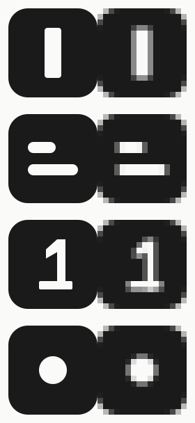
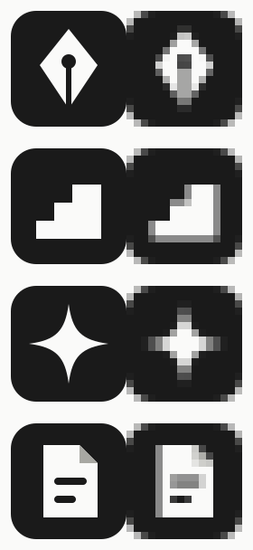

# Favicon ideas

All four use the site's ink and paper colors and flip in dark mode. Left is 128px, right is the real 16px tab size, enlarged.

1. **Cursor** (`1-cursor.svg`): a text caret. "Just start typing."
2. **Two streams** (`2-two-streams.svg`): a short line and a long one, for notes and posts. **Currently used** as `public/favicon.svg`.
3. **One** (`3-one.svg`): the "1" from 1tsu.net.
4. **Period** (`4-period.svg`): a single dot. Done is better than perfect.

To switch, copy the option over `public/favicon.svg`.

## Second set

5. **Nib** (`5-nib.svg`): a pen nib, for writing. The slit blurs at 16px.
6. **Elevations** (`6-elevations.svg`): steps going up, from "experiment at various elevations" on the About page.
7. **Spark** (`7-spark.svg`): the four-point sparkle. Reads instantly as AI, but many AI products use it.
8. **Page** (`8-page.svg`): a sheet with a folded corner and two lines of text.
